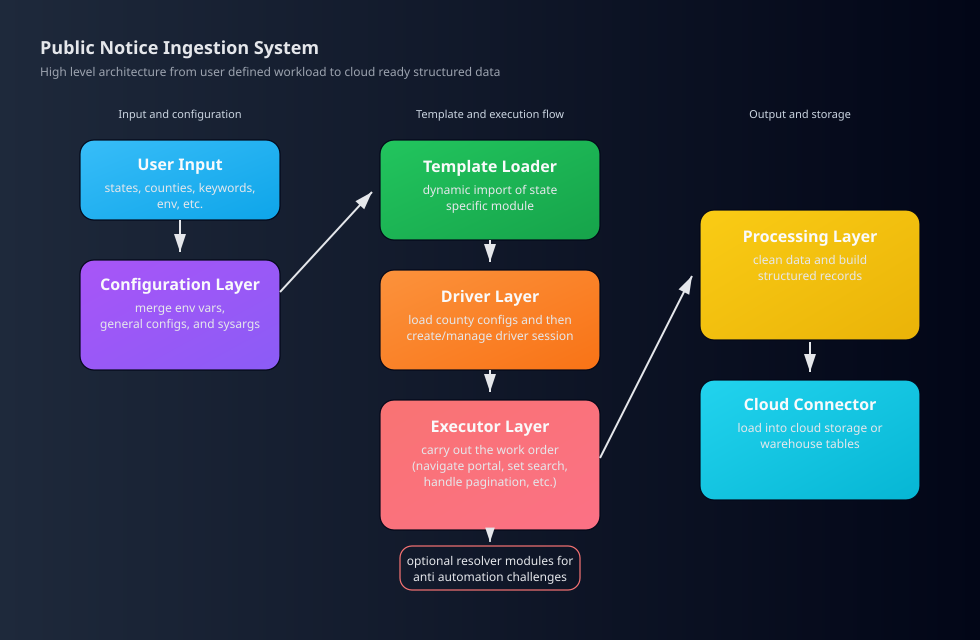

<a id="table-of-contents"></a>

## 📖 Table of Contents

- [📜 Disclaimer](#disclaimer)
- [🗂️ Business Context](#business_context)
- [❗ Business Problem](#business_problem)
- [🗺️ Project Overview](#project_overview)
- [🏆 Business Outcome](#business_outcome)
- [⭐ Key Features](#key_features)
- [🧰 Tech Stack](#tech_stack)
- [🏛️ System Architecture](#system_architecture)
- [🔗 How the System Works](#how_the_system_works)
- [🏗️ Repository Structure](#repository_structure)
- [🔎 How to Review This Repository](#how_to_review_this_repository)
<details open>
<summary id="disclaimer"><b>📜 Disclaimer</b></summary>

This repository showcases a curated example of my engineering work. To protect confidentiality, all sensitive logic, configurations, and details have been removed. What remains is a faithful representation of how I design, implement, and think through building data pipelines and systems.

[📖 Table Of Contents](#table-of-contents)


</details>

<details open>
<summary id="business_context"><b>🗂️ Business Context</b></summary>

This project supported an initiative to create an early warning system that monitors changes in clean energy projects. State public notice portals contain the first signals of progress or delay but the way this information is published varies from state to state. Manual review created delays and left information gaps. This project lays the foundation for a structured and automated ingestion layer that can track these signals at scale.

[📖 Table Of Contents](#table-of-contents)


</details>

<details open>
<summary id="business_problem"><b>❗ Business Problem</b></summary>

The team needed a way to gather early project information across all states but there was no consistent source that could provide it. Public notice portals were scattered and unstructured, with each state presenting information in its own way. This made it hard to track patterns at scale, support community groups at the right time, correct misinformation, and follow project timelines with the speed many situations required. A dependable solution was needed to turn these scattered signals into a usable stream of information.

[📖 Table Of Contents](#table-of-contents)


</details>

<details open>
<summary id="project_overview"><b>🗺️ Project Overview</b></summary>
I built a data ingestion framework that collects public notice information from state portals and prepares it for cloud analytics. It uses a template based structure that separates state specific extraction logic from the core workflow. The system automates searches, processes results, and turns each notice into a structured record ready for downstream warehouse environments. The workload is driven by user inputs like which states, counties, search terms, etc. to process, which keeps the system flexible and efficient. The design focuses on clarity, long term maintainability, and the ability to add new states or workflows without major changes to the underlying infrastructure.


[📖 Table Of Contents](#table-of-contents)


</details>

<details open>
<summary id="business_outcome"><b>🏆 Business Outcome</b></summary>

Before this system, the team had no unified way to track early signals. After deployment, they had the first nationwide view of project activity, updated continuously and ready for action. It allowed them to support communities at the right moment, push back on misinformation, and spot slowdowns early. The structured output now serves as the backbone for analytics, dashboards, and ongoing enhancements to the early warning effort.

[📖 Table Of Contents](#table-of-contents)


</details>

<details open>
<summary id="key_features"><b>⭐ Key Features</b></summary>

<table>
<tr>
<td width="50%" valign="top">

⚙️ <b>Config Driven Logic</b><br>
<sub>General and specific extraction rules and workflow settings are controlled entirely through configuration files.</sub>

📁 <b>Modular State Templates</b><br>
<sub>Each state is defined as its own template or group template, allowing the core pipeline to remain clean as new sources are added.</sub>

⏳ <b>Lookback Filtering</b><br>
<sub>Capture only recent notices or listings within a defined time window to reduce noise and optimize run time.</sub>

</td>
<td width="50%" valign="top">

🎛️ <b>User-Defined Workloads</b><br>
<sub>Run only the tasks you need by selecting target states, counties, keywords, etc. at runtime.</sub>

🧭 <b>Automated Browser Workflows</b><br>
<sub>Navigate portals, perform searches, and collect results even when no API is available.</sub>

📐 <b>Structured Output for Cloud Analytics</b><br>
<sub>Normalize extracted records into a consistent schema ready for loading into warehouse or lake environments.</sub>

</td>
</tr>
</table>

[📖 Table Of Contents](#table-of-contents)


</details>

</details>

<details open>
<summary id="tech_stack"><b>🧰 Tech Stack</b></summary>

<div align="center" style="display:flex; flex-wrap:wrap; justify-content:center; gap:6px; margin:0 auto;">

[](https://www.prefect.io/)
[](https://www.python.org/)
[](https://developer.mozilla.org/en-US/docs/Web/JavaScript)
[](https://www.assemblyai.com/)
[![Camoufox](https://img.shields.io/badge/Camoufox-black?style=for-the-badge&logo=data%3Aimage%2Fpng%3Bbase64%2CiVBORw0KGgoAAAANSUhEUgAAABgAAAAYCAMAAADXqc3KAAABqlBMVEUTDRoaEiQVEB4YECETDhwWDB0YESIbEyYWDh4SDBgjIC8mKTUYFCEQChYrOUMWxvQnzvArPkUaGCggJTMRxvkbyPIhyvEVGCQXHC0mLzYnWGkt0O4nQlEqUF9C2eg%2FWFRa4d%2BFx6Bfj3xDq7FBenojHC1FkJEgaYEdNUg0q78hLTxWrKZCYV1e5OBHx9FBcHM2SUxs08Jlx7qC6MuK9dI4WF8Ps%2BMUPlZomoJVgXNXk4ZJlpc6gosrbnwru9dKn6BOcWYto7tsvqkliKNnsZ5AtcEtYHBJ2%2BUmNEJC0N5XnJA4ipZe2dR63sSD8tQyTFUPVnUPmMNup4svPjsTuukPUGwQwPN5sZJiv7IXIjEsttBNi4YglrQWrtgVkrYdosVuq5IgfJgec4411e4jPVA2m6wxfI0rdYl9waBTw8Mvip0uV2V%2FvptT3uIpR1dv5dVzw6pMtbhO1dtmt6eC0K1i0MZUp6M5aHGE4L977dRs2sp46NJUd2lmpIxVfnEQNkw0lqYhy%2FEOi7QXYX5p6N0wxN1KvcNO3uV6yatepJmS%2B9N907Zay8dOg3%2B9NlaoAAAB%2BklEQVQozy2SVXfbQBBG15GyWluyEkltzZYZZKbGGDPHdhpmhgYabLjM%2BJ%2B7UjoP%2B3Dvztk93wwgcQGgZaZL6am3jqCBVJNDcgGZaxlx3r7heJfJ1ipZDgBFMJgbpuxvDAzCxXPLCy6dbICG0U7b0zQiVHJBRHCBnB7Iws3aMwzGFEXhAyuh6NGRWNDzDgaqZMobWNkiwVnAgigdawiVGzdGfsbiyzkz7jHXWwhojoOIiF6eVXr9u1js9MtB7gjCbt4NRNxAbfxKJvvxCMtdh0Khc2nY7G%2BBtANB8TbZTwQG16mbCZvtVXPXpy8bwcsgEm8Tid7flpAanIds38JN6z6s7oPXUfp3Mlu7u49fBv5MHITrjbr1kNmqYiGcJXoPD6f38eKN2dJt7xW2v%2Fq8VfBDRHQ0FUwNWEFz0g1brYdGk8m7tQlqJRyQREusxeW8%2BN60to2bptH1tc8g04F8J3Z1Jf%2Fnoh32Nyzjo89Gno8BrmJAdMTjyUcaR5YT844X86dPXuAcOy4ECSVBaW%2B3PG7CfGRuchhouQUWydFSFL%2Fj31Y4bsBTBa6AgJTUKZVvSeH4BTxaoPMUJQQVRXg%2FYj4zSSozV%2BvyTguPCAgh8s3g%2B7PkoyDVQ0bnB6Ok5%2FnFsdW5T%2B8B%2BX9L8DosFvxL5ZWV9dW1Wd3j%2FvwDqONcH4dI1AIAAAAASUVORK5CYII%3D)](https://camoufox.com/)
[](https://cloud.google.com/?hl=en)

</div>

[📖 Table Of Contents](#table-of-contents)


</details>

<details open>
<summary id="system_architecture"><b>🏛️ System Architecture</b></summary>



[📖 Table Of Contents](#table-of-contents)


</details>

<details open>
<summary id="how_the_system_works"><b>🔗 How the System Works</b></summary>

The system runs through a clear sequence of steps that takes user defined inputs, applies configuration, runs state templates, and produces structured, cloud ready records.

1. <b>User defines the workload</b><br>
   The run starts with user inputs such as states, counties, keywords, target environment, etc. These values describe what should be processed in this session.

2. <b>Runtime arguments and defaults are merged</b><br>
   The program loads environment variables and general configurations, then combines them with the CLI arguments into a single `runtime_sysargs` object. This includes any default states, counties, keywords, and other general settings. Arguments are validated against the allowed values so that only supported processes move forward.

3. <b>The state template is loaded and validated</b><br>
   For each state in the workload, the system loads that state’s configuration and dynamically imports the corresponding template module. It checks that the template implements all required functions before proceeding. This keeps the core pipeline stable while allowing each state to have its own logic.

4. <b>Counties and county configs are prepared inside the template</b><br>
   For each state, the workload already includes a `counties_to_extract` list that comes from the runtime arguments and/or configurations. The template iterates over that list. For each county, it then loads the county's configurations. These configs describe county level details such as URLs, selectors, or other behavior the executor needs to know. This keeps the choice of counties in the system arguments, while the template focuses on how to handle each one.

5. <b>A browser driver and executor run the extraction workflow</b><br>
   For each county, the driver factory instantiates a browser driver based on the county configuration and places it under a context manager. The template then invokes the executor module for that state, which manages the interactive workflow:

   - navigating the public notice portal
   - setting the search term and search phrase
   - applying the current county (when required)
   - submitting the search
   - managing pagination and optimizing the results view

6. <b>Anti automation resolver runs only when needed</b><br>
   When the executor opens a specific notice, it may trigger bot protection such as a reCAPTCHA challenge. In that case, the resolver module takes over briefly to handle the challenge and then returns control to the executor. If no challenge is present, the resolver path is skipped and the executor continues normally.

7. <b>Each notice is processed into a structured record</b><br>
   For each notice, the executor retrieves the notice content, cleans it, and returns the data to the template. The template updates metadata as needed, applies lookback logic, and decides when to stop processing. The cleaned notice, along with metadata such as publication date, excerpt, keyword, state, and county, is packaged into a payload context for loading.

8. <b>Data is formatted and loaded into the warehouse</b><br>
   The cloud connector formats the payload into the schema expected by the warehouse and loads it into the appropriate tables, using the target environment (for example staging or production). This produces an analytics ready layer that downstream tools can use for monitoring, early warning dashboards, and further modeling.

[📖 Table Of Contents](#table-of-contents)


</details>

<details open>
<summary id="repository_structure"><b>🏗️ Repository Structure</b></summary>

```
.
├── assets      # Stores resources to support this README
│
├── code        # Code samples
│   ├── executors       # Stores executors
│   |    └── camoufox.py            # Executor sample
│   |
│   ├── templates       # Stores templates
│   │   └── group_id_1.py           # Template sample
│   |
│   └── public_notice_extractor.py  # Entry point
│
└── README.md   # This README
```

[📖 Table Of Contents](#table-of-contents)


</details>

<details open>
<summary id="how_to_review_this_repository"><b>🔎 How to Review This Repository</b></summary>
This section walks reviewers through the core files in this repository. The quickest way to understand the system is to look at three files that map directly to the major stages shown in the system architecture diagram above.

### **1. Start with the entry point**

`code/public_notice_extractor.py`  
This file initializes the runtime environment, merges general configs and CLI arguments, loads the state template at runtime, builds the extraction context, and triggers the template run for each state.

### **2. Check out a template**

`code/templates/group_id_1.py`  
This file shows how a state template coordinates an extraction session. It loads the correct executor module, prepares the list of counties to process, and drives the main county to keyword loop. Inside each county, it loads its configuration, starts the driver session defined by that configuration, runs searches, moves through pagination, tracks head and tail notice metadata, and sends each notice forward for cleaning and loading into storage.

### **3. Look at an executor**

`code/executors/camoufox.py`  
This file defines the executor that carries out all driver actions during extraction. It navigates to the portal, applies county and keyword inputs, submits searches, handles pagination, performs the steps needed to extract notices, etc. It provides the step level workflow that the template uses repeatedly in the county to keyword loop.

Together, these files show the architecture, modular boundaries, and execution pattern the full system used while running multi-state workloads.

[📖 Table Of Contents](#table-of-contents)

</details>
